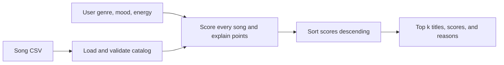

# VibeFinder 1.0 - Music Recommender Simulation

A CLI-first, content-based music recommender for CodePath AI110 Project 3. It loads 20 fictional songs, scores every song against a taste profile, and prints the top five with an explanation for every score. It includes three main profiles, two edge cases, and a reproducible weight experiment.

Built from the [official CodePath starter](https://github.com/codepath/ai110-module3show-musicrecommendersimulation-starter). The starter's ten songs and object interface are preserved; ten AI-generated example songs expand the catalog.

## Getting Started

Requires **Python 3.10 or newer**. The application uses only the Python standard library.

Open a terminal in this `music-recommender` folder and run:

```console
python -m src.main
```

Other reproducible runs:

```console
python -m src.main --profile lofi
python -m src.main --profile rock
python -m src.main --all-profiles
python -m src.main --profile pop --experiment
python -m src.main --all-profiles --experiment
python -m src.main --profile conflicting --k 3
python -m src.main --csv data/songs.csv
```

`--k` defaults to five. Zero returns no suggestions; negative values are rejected. Requests larger than the catalog return all available songs. Use `python -m src.main --help` for options. The default CSV path is resolved from the package location.

### Running Tests

```console
python -m pip install -r requirements.txt
python -m pytest -q
```

Verification: **35 tests passed**, including the two unchanged starter tests. Checks cover exact scores and explanations, energy closeness, invalid values, CSV conversion, deterministic ties, unchanged input order, object compatibility, and a ranking change under different weights. These checks establish software behavior; they do not measure listeners' satisfaction.

## How The System Works

Real platforms use signals about both people and content. **Collaborative filtering** looks for patterns in shared behavior: people who enjoyed similar items may enjoy other items in common. **Content-based filtering** compares an item's attributes with a person's preferences. See Google's explanations of [collaborative filtering](https://developers.google.com/machine-learning/recommendation/collaborative/basics) and [content-based filtering](https://developers.google.com/machine-learning/recommendation/content-based/basics).

Spotify describes signals such as searches, listening, skips, saves, similar listeners' behavior, and content metadata in [Understanding recommendations](https://www.spotify.com/us/safetyandprivacy/understanding-recommendations/plain). Likes and playlist membership are other possible preference signals in a recommendation design. This simulation collects no behavior: the user explicitly supplies a genre, mood, and target energy. It applies a fixed scoring recipe without training a model. The energy and tempo values here are illustrative catalog attributes; this project makes no claim about Spotify's actual scoring formula.

### Data and Taste Profiles

| Data | Fields | Role |
| --- | --- | --- |
| Song identity | `id`, `title`, `artist` | Display and identify a song; no score points |
| Scored categories | `genre`, `mood` | Compare with the preferred labels |
| Scored number | `energy` | Compare with target intensity, on a 0-1 scale |
| Other catalog numbers | `tempo_bpm`, `valence`, `danceability`, `acousticness` | Loaded and validated; available for future experiments |
| User preference dictionary | `genre`, `mood`, `energy` | One preferred genre, one mood, and target energy |
| Starter `UserProfile` object | `favorite_genre`, `favorite_mood`, `target_energy`, `likes_acoustic` | Adapter to the same algorithm; `likes_acoustic` is retained but is not scored |

`Song` is a dataclass with all ten CSV attributes. `load_songs` uses Python's `csv` module and returns dictionaries: IDs become integers and all five numeric attributes become floats. Energy, valence, danceability, and acousticness must be finite values from 0 to 1; tempo must be positive. Headers, nonempty fields, and unique positive IDs are checked. Categories ignore case and surrounding whitespace. The functional scorer also accepts the longer preference keys used by `UserProfile`.

The catalog has **20 fictional songs, 14 distinct genres, and 13 mood labels**. The first ten rows come from the starter. Rows 11-20 add pop, R&B, Indian classical, afrobeats, country, salsa, classical, rock, and hip hop examples, including new moods such as peaceful and nostalgic. The labels and numeric values are synthetic descriptions, not audio measurements or claims about whole musical traditions.

### Algorithm Recipe

```text
score = 2.0 * genre_match
      + 1.0 * mood_match
      + 1.0 * (1 - abs(song_energy - target_energy))
```

A match is 1; a mismatch is 0. The baseline score ranges from 0 to 4 and is a relevance score, not a probability. Energy proximity rewards closeness symmetrically: energies 0.6 and 1.0 each earn 0.8 points for a target of 0.8. Increasing energy alone does not always improve the score.

Genre gets two points because it represents a broad preference; mood gets one point to distinguish contexts within that genre. Energy gets up to one point so intensity can order similar songs. These are deliberate design choices, not learned weights. For example, Sunrise City earns 2 + 1 + (1 - |0.82 - 0.80|) = **3.98** for the default profile.

`score_song` judges **one song** and returns `(score, reasons)`. `recommend_songs` judges **every song**, sorts the results from highest to lowest, and returns the top k tuples `(song, score, explanation)`. A good scoring rule alone does not select a list; the ranking step is also necessary. Full numerical scores determine order; display values use two decimals. Exact ties keep the catalog order.

Python's `sorted()` creates a new list, leaving the catalog's order intact. A list's `.sort()` changes that list in place and returns `None`. This project uses `sorted()` so repeated profile comparisons do not alter the input catalog.



Expected bias: two genre points can outweigh mood and energy, creating a filter bubble. Exact labels also separate `pop` from `indie pop`, even if a listener considers them related. The experiment below tests that choice.

## Sample Recommendation Output

All fenced results below were captured by running the code with the included catalog. The first three profiles are the main evaluation; the final two stress-test conflicting preferences and missing categories. Complete captures are also saved in [evaluation/profiles.txt](evaluation/profiles.txt).

### High-Energy Pop

```console
python -m src.main --profile pop
Loaded songs: 20

Profile: High-Energy Pop
Preferences: genre=pop, mood=happy, energy=0.80
Weights: genre=2.00, mood=1.00, energy=1.00
1. Sunrise City - Neon Echo | Score: 3.98
   Because: genre match (+2.00); mood match (+1.00); energy similarity 0.98 (+0.98)
2. Golden Hour Parade - Daylight Avenue | Score: 3.98
   Because: genre match (+2.00); mood match (+1.00); energy similarity 0.98 (+0.98)
3. Neon Goodbye - Electric Letters | Score: 2.92
   Because: genre match (+2.00); mood mismatch (+0.00); energy similarity 0.92 (+0.92)
4. Gym Hero - Max Pulse | Score: 2.87
   Because: genre match (+2.00); mood mismatch (+0.00); energy similarity 0.87 (+0.87)
5. Rooftop Lights - Indigo Parade | Score: 1.96
   Because: genre mismatch (+0.00); mood match (+1.00); energy similarity 0.96 (+0.96)
```

### Chill Lofi

```console
python -m src.main --profile lofi
Loaded songs: 20

Profile: Chill Lofi
Preferences: genre=lofi, mood=chill, energy=0.35
Weights: genre=2.00, mood=1.00, energy=1.00
1. Library Rain - Paper Lanterns | Score: 4.00
   Because: genre match (+2.00); mood match (+1.00); energy similarity 1.00 (+1.00)
2. Midnight Coding - LoRoom | Score: 3.93
   Because: genre match (+2.00); mood match (+1.00); energy similarity 0.93 (+0.93)
3. Focus Flow - LoRoom | Score: 2.95
   Because: genre match (+2.00); mood mismatch (+0.00); energy similarity 0.95 (+0.95)
4. Spacewalk Thoughts - Orbit Bloom | Score: 1.93
   Because: genre mismatch (+0.00); mood match (+1.00); energy similarity 0.93 (+0.93)
5. Coffee Shop Stories - Slow Stereo | Score: 0.98
   Because: genre mismatch (+0.00); mood mismatch (+0.00); energy similarity 0.98 (+0.98)
```

### Deep Intense Rock

```console
python -m src.main --profile rock
Loaded songs: 20

Profile: Deep Intense Rock
Preferences: genre=rock, mood=intense, energy=0.90
Weights: genre=2.00, mood=1.00, energy=1.00
1. Storm Runner - Voltline | Score: 3.99
   Because: genre match (+2.00); mood match (+1.00); energy similarity 0.99 (+0.99)
2. Afterburn - Iron Meridian | Score: 3.99
   Because: genre match (+2.00); mood match (+1.00); energy similarity 0.99 (+0.99)
3. Gym Hero - Max Pulse | Score: 1.97
   Because: genre mismatch (+0.00); mood match (+1.00); energy similarity 0.97 (+0.97)
4. Neon Goodbye - Electric Letters | Score: 0.98
   Because: genre mismatch (+0.00); mood mismatch (+0.00); energy similarity 0.98 (+0.98)
5. Salsa Skyline - Barrio Brisa | Score: 0.97
   Because: genre mismatch (+0.00); mood mismatch (+0.00); energy similarity 0.97 (+0.97)
```

### Edge Case: High-Energy Sad Pop

```console
python -m src.main --profile conflicting
Loaded songs: 20

Profile: Conflicting: High-Energy Sad Pop
Preferences: genre=pop, mood=sad, energy=0.90
Weights: genre=2.00, mood=1.00, energy=1.00
1. Neon Goodbye - Electric Letters | Score: 3.98
   Because: genre match (+2.00); mood match (+1.00); energy similarity 0.98 (+0.98)
2. Gym Hero - Max Pulse | Score: 2.97
   Because: genre match (+2.00); mood mismatch (+0.00); energy similarity 0.97 (+0.97)
3. Sunrise City - Neon Echo | Score: 2.92
   Because: genre match (+2.00); mood mismatch (+0.00); energy similarity 0.92 (+0.92)
4. Golden Hour Parade - Daylight Avenue | Score: 2.88
   Because: genre match (+2.00); mood mismatch (+0.00); energy similarity 0.88 (+0.88)
5. Velvet Heartbreak - Solstice Letters | Score: 1.58
   Because: genre mismatch (+0.00); mood match (+1.00); energy similarity 0.58 (+0.58)
```

### Edge Case: Unavailable Genre and Mood

```console
python -m src.main --profile unknown
Loaded songs: 20

Profile: Unknown Genre and Mood
Preferences: genre=opera, mood=mysterious, energy=0.50
Weights: genre=2.00, mood=1.00, energy=1.00
1. Velvet Heartbreak - Solstice Letters | Score: 0.98
   Because: genre mismatch (+0.00); mood mismatch (+0.00); energy similarity 0.98 (+0.98)
2. Red Dirt Goodbye - Juniper Trail | Score: 0.96
   Because: genre mismatch (+0.00); mood mismatch (+0.00); energy similarity 0.96 (+0.96)
3. Midnight Coding - LoRoom | Score: 0.92
   Because: genre mismatch (+0.00); mood mismatch (+0.00); energy similarity 0.92 (+0.92)
4. Focus Flow - LoRoom | Score: 0.90
   Because: genre mismatch (+0.00); mood mismatch (+0.00); energy similarity 0.90 (+0.90)
5. Coffee Shop Stories - Slow Stereo | Score: 0.87
   Because: genre mismatch (+0.00); mood mismatch (+0.00); energy similarity 0.87 (+0.87)
```

## Experiments You Tried

The controlled experiment changes only feature weights: genre drops from **2 to 1**, energy rises from **1 to 2**, and mood stays at **1**. The catalog, profile, and k stay fixed. Both weight sets sum to four, and energy similarity remains between zero and one, keeping the score range valid. Frozen `ScoringWeights` configurations keep the baseline intact. Run `python -m src.main --profile pop --experiment` to reproduce both rankings.

| Song | Baseline rank / score | Energy-focused rank / score | Explanation |
| --- | --- | --- | --- |
| Sunrise City | 1 / 3.98 | 1 / 3.96 | Genre and mood still match |
| Golden Hour Parade | 2 / 3.98 | 2 / 3.96 | Same rounded score; catalog order breaks the tie |
| Rooftop Lights | 5 / 1.96 | 3 / 2.92 | Matching happy mood and nearby energy now beat two mood-mismatched pop songs |
| Neon Goodbye | 3 / 2.92 | 4 / 2.84 | Less benefit from genre alone |
| Gym Hero | 4 / 2.87 | 5 / 2.74 | Intense mood and larger energy gap matter more |

The top-five membership stays the same, but the ordering changes. Moving a happy song above sad or intense songs seems better aligned with the stated happy preference. Without human listening feedback, this is an interpretable difference, not demonstrated accuracy improvement.

### Captured Experiment Output

```console
python -m src.main --profile pop --experiment
Loaded songs: 20

=== Baseline ===

Profile: High-Energy Pop
Preferences: genre=pop, mood=happy, energy=0.80
Weights: genre=2.00, mood=1.00, energy=1.00
1. Sunrise City - Neon Echo | Score: 3.98
   Because: genre match (+2.00); mood match (+1.00); energy similarity 0.98 (+0.98)
2. Golden Hour Parade - Daylight Avenue | Score: 3.98
   Because: genre match (+2.00); mood match (+1.00); energy similarity 0.98 (+0.98)
3. Neon Goodbye - Electric Letters | Score: 2.92
   Because: genre match (+2.00); mood mismatch (+0.00); energy similarity 0.92 (+0.92)
4. Gym Hero - Max Pulse | Score: 2.87
   Because: genre match (+2.00); mood mismatch (+0.00); energy similarity 0.87 (+0.87)
5. Rooftop Lights - Indigo Parade | Score: 1.96
   Because: genre mismatch (+0.00); mood match (+1.00); energy similarity 0.96 (+0.96)

=== Experiment: halve genre weight; double energy weight ===

Profile: High-Energy Pop
Preferences: genre=pop, mood=happy, energy=0.80
Weights: genre=1.00, mood=1.00, energy=2.00
1. Sunrise City - Neon Echo | Score: 3.96
   Because: genre match (+1.00); mood match (+1.00); energy similarity 0.98 (+1.96)
2. Golden Hour Parade - Daylight Avenue | Score: 3.96
   Because: genre match (+1.00); mood match (+1.00); energy similarity 0.98 (+1.96)
3. Rooftop Lights - Indigo Parade | Score: 2.92
   Because: genre mismatch (+0.00); mood match (+1.00); energy similarity 0.96 (+1.92)
4. Neon Goodbye - Electric Letters | Score: 2.84
   Because: genre match (+1.00); mood mismatch (+0.00); energy similarity 0.92 (+1.84)
5. Gym Hero - Max Pulse | Score: 2.74
   Because: genre match (+1.00); mood mismatch (+0.00); energy similarity 0.87 (+1.74)
```

The same run is saved in [evaluation/weight_experiment.txt](evaluation/weight_experiment.txt). [model_card.md](model_card.md) compares all profile pairs, discusses edge cases, and explains why Gym Hero can appear for different users.

## Limitations and Risks

The catalog is small and hand-labeled, with unequal coverage across genres. The score has no understanding of lyrics, language, culture, listening history, artist preferences, or audio. A preference for an absent genre falls back to mood and energy, so a returned result can still be a poor musical match. Single genre and mood labels oversimplify taste; high scores express agreement with this recipe rather than proof that a person will enjoy a song. The implementation does not enforce artist diversity, and an early CSV row wins an exact tie.

## Reflection

The [Model Card](model_card.md#9-personal-reflection) contains a project-specific **AI-assisted reflection draft** for the student to review and personalize. [ai_interactions.md](ai_interactions.md) records the actual request, AI assistance, design decisions, and verification without claiming that the student personally performed those checks.

## Project Files

```text
music-recommender/
  data/songs.csv                 # Original 10 songs plus 10 added examples
  src/recommender.py            # Validation, scoring, ranking, starter adapters
  src/main.py                   # Profiles, readable CLI, controlled experiment
  tests/test_recommender.py     # Unchanged starter tests
  tests/test_functional.py      # Additional functional and edge-case checks
  evaluation/profiles.txt       # Actual five-profile output
  evaluation/weight_experiment.txt
  model_card.md                 # Intended use, evaluation, biases, reflection
  ai_interactions.md            # Honest account of AI assistance
  SUBMISSION.md                 # Remaining GitHub/course steps
```

The local implementation and evaluation are complete. Review the reflection, publish the project to your own public fork, and submit its URL through the course site using [SUBMISSION.md](SUBMISSION.md).
